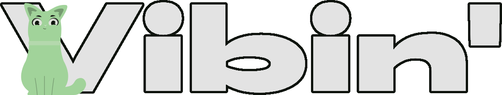

<div align="center">



### Your Personal Music Streaming Server

*Upload, manage, and stream your music collection from anywhere*


[](LICENSE.md)
[](https://hub.docker.com/r/mickkc/vibin)


</div>

---

||||||
|-|-|-|-|-|

---

> [!NOTE]
> This is the server repository. The client can be found [here](https://codeberg.org/mickkc/vibin-app).

> [!CAUTION]
> **Development Status**: This project is actively being developed. Breaking changes may occur without prior notice. Use at your own risk.

<!-- TOC -->
  * [Features](#features)
  * [Quickstart](#quickstart)
  * [Usage](#usage)
  * [Credits](#credits)
  * [License](#license)
<!-- TOC -->

---

## Features

<table>
<tr>
<td width="50%">

**Core Functionality**
- Upload and manage your music collection
- Stream to any device with a browser or app
- Create and manage playlists
- Advanced search and filtering
- User management and permissions

</td>
<td width="50%">

**Advanced Capabilities**
- Dynamic playlist creation
- Powerful query language
- Tag-based organization
- Lyrics & metadata search support
- Customizable widgets for embedding
</td>
</tr>
</table>

---

## Quickstart

1. Make sure you have [Docker](https://docs.docker.com/engine/install) and [Docker Compose](https://docs.docker.com/compose/install/)
   installed on your system.
2. Download / copy the [example docker-compose.yml](docker-compose.example.yml) file and the [example .env](.env.example) file and 
   modify them to your needs using the [configuration wiki](https://vibin.rip/docs/config).
3. Run the following command:
    ```bash
    docker compose up -d
    ```
4. You can now access the application at `http://localhost:8080`. (Or the port you specified in the docker-compose.yml file.)
5. Login with the default credentials (username `Admin`, password `admin`)
6. CHANGE THE PASSWORD OF THE ADMIN USER IMMEDIATELY!
7. Configure the [metadata settings](https://vibin.rip/docs/config#metadata-settings) and run the [first scan](https://vibin.rip/docs/first-scan) to add your library.

> [!NOTE]
> For other installation methods, check out the [installation wiki page](https://vibin.rip/docs/installation).

---

## Usage

To learn more about Vibin', you can check out the [Wiki](https://vibin.rip/docs/category/usage) (work in progress).

---

## Credits

Thank you to everyone who contributed to Vibin'! ❤️

- **@Vistaus** - Dutch translation
- **@rhododendrhon** - Romanian translation
- **@WreckingBANG**, **@blorg** - Testing, Issue reporting

---

## License

This project is licensed under the **[GNU General Public License v3.0](LICENSE.md)** (GPLv3).

```
Vibin' - Self-hosted music streaming server
Copyright (C) 2026 mickkc

This program is free software: you can redistribute it and/or modify
it under the terms of the GNU General Public License as published by
the Free Software Foundation, either version 3 of the License, or
(at your option) any later version.

This program is distributed in the hope that it will be useful,
but WITHOUT ANY WARRANTY; without even the implied warranty of
MERCHANTABILITY or FITNESS FOR A PARTICULAR PURPOSE. See the
GNU General Public License for more details.

You should have received a copy of the GNU General Public License
along with this program. If not, see <https://www.gnu.org/licenses/>.
```

**Mascot:** The project mascot was commissioned from a freelance artist. All rights have been exclusively assigned to
the project maintainer and are licensed under the same GPLv3 terms.